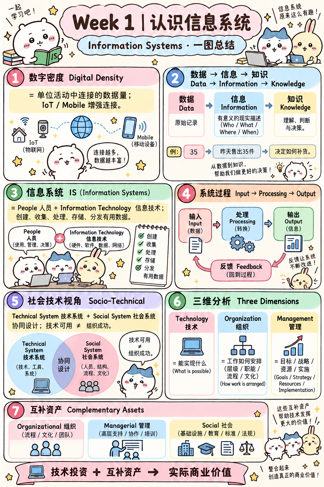
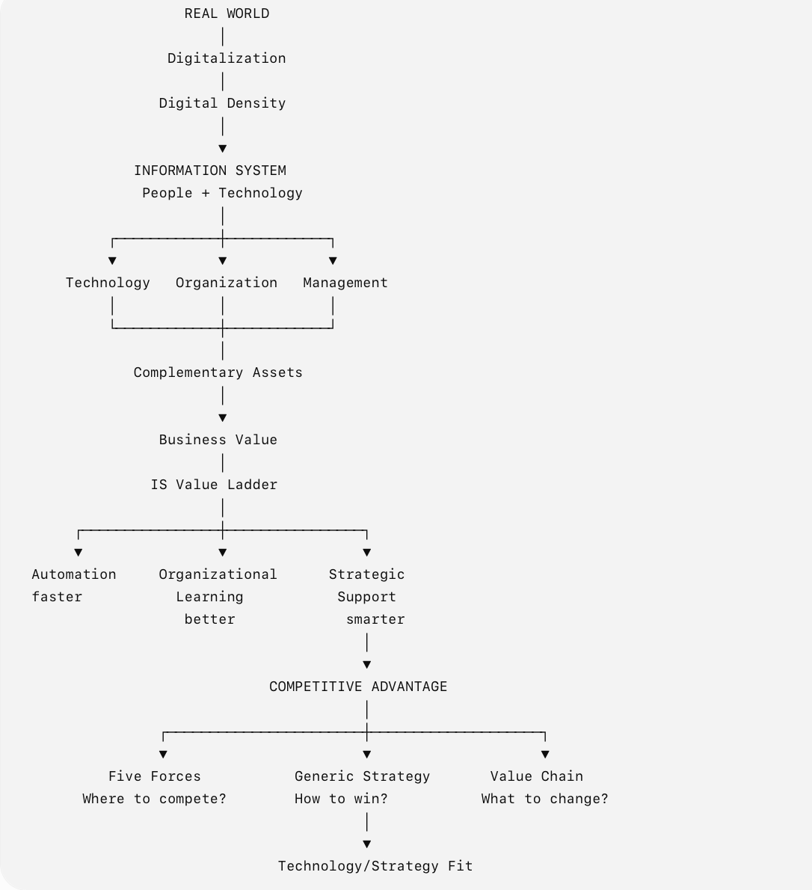
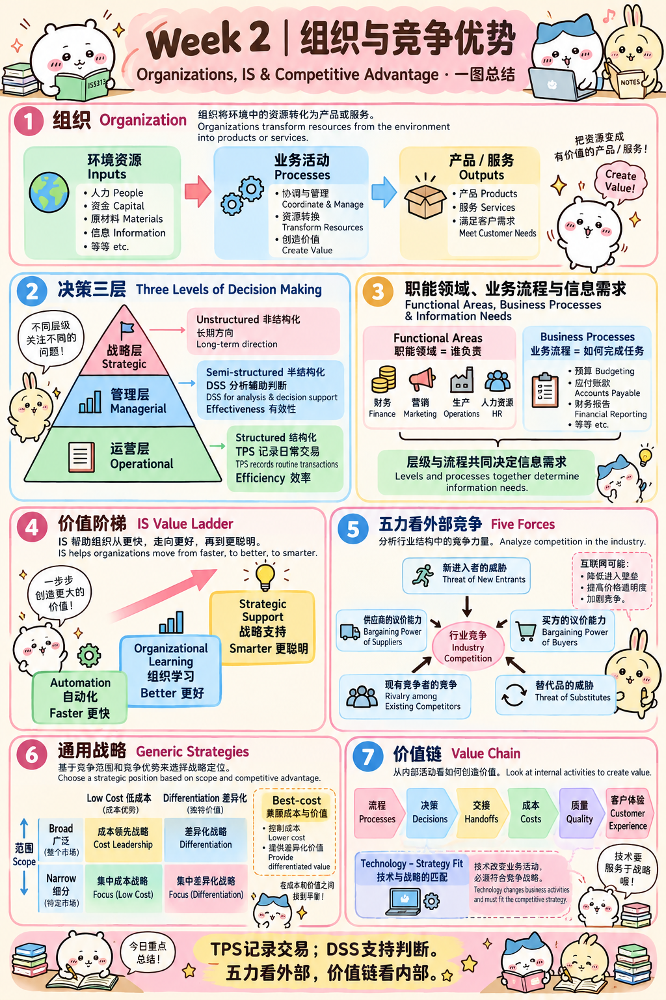
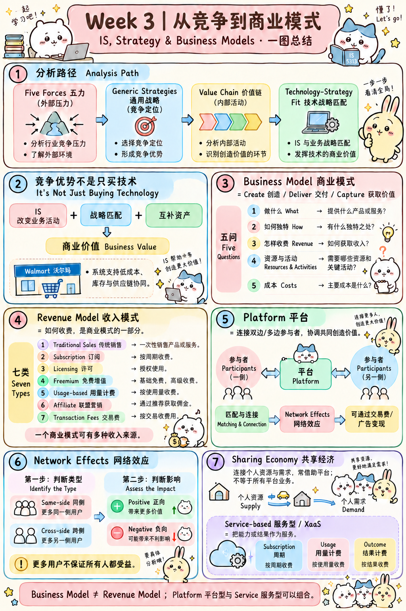
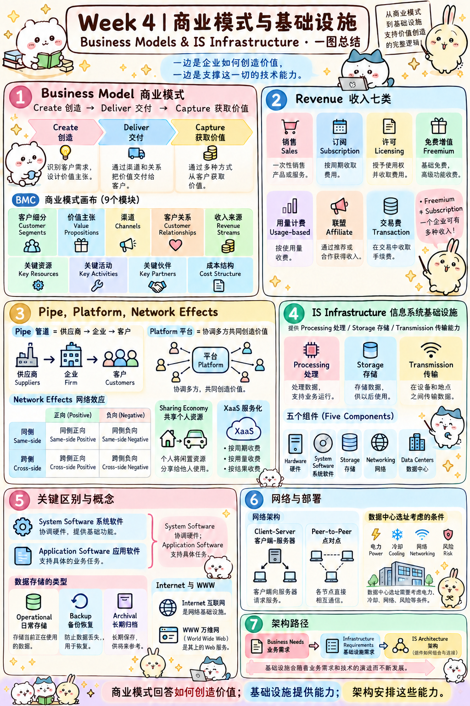
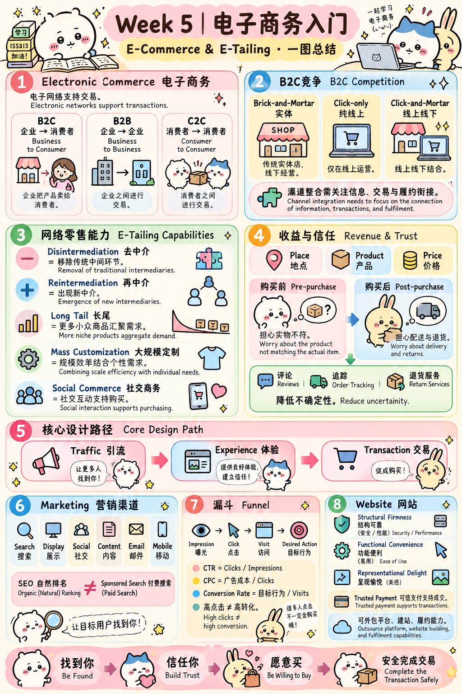
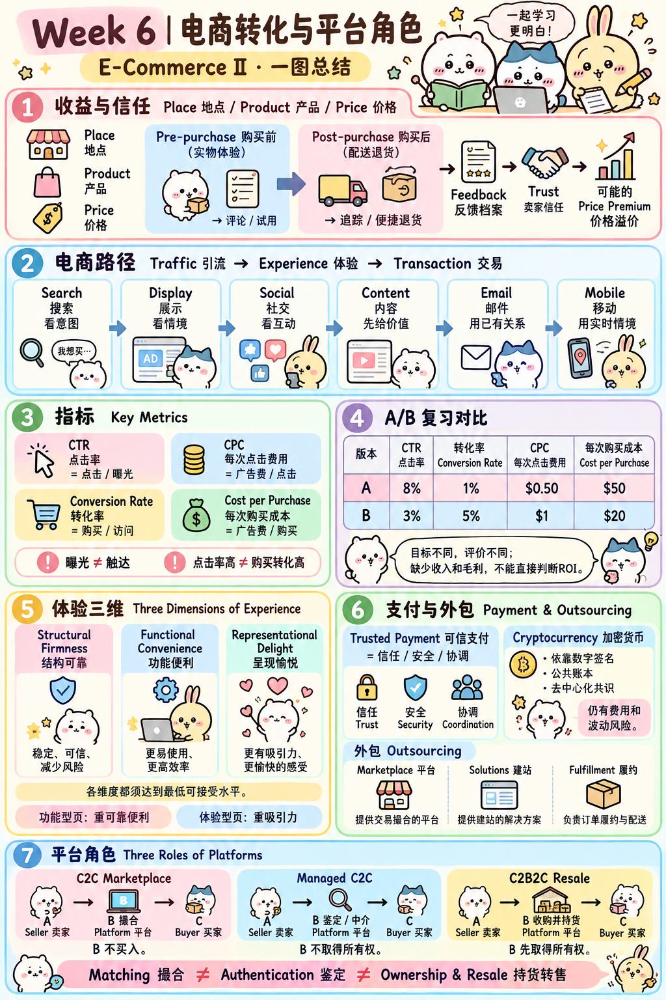

# IS 5313 Fndns of Infor. & Elect. Bus. Sys（信息与电子商务系统基础）

# Week 1（第一周：认识 Information Systems / 信息系统）

**主线：Digital Density（数字密度）→ Data / Information / Knowledge（数据 / 信息 / 知识）→ Information System（信息系统）→ Socio-Technical Perspective（社会技术视角）→ Three Dimensions（三维模型）→ Complementary Assets（互补资产）**

### 定义（Definitions）

#### Information System（IS，信息系统）

> **An information system is the combination of people and information technology that create, collect, process, store, and distribute useful data.**
>
> **中文**：信息系统是**人员（People）与信息技术（Information Technology）**的结合，用来创建、收集、处理、存储和分发**有用的数据（Useful Data）**。

**核心关键词**：**People（人） + Information Technology（信息技术） + Useful Data（有用的数据）**。

> **不要只把 IS 理解为软件或电脑。** 同一套技术是否有用，还涉及使用它的人与组织工作方式。

*PPT：W1 第 30 页。*

#### Digital Density（数字密度）

> **Digital density = The amount of connected data per unit of activity.**
>
> **中文**：数字密度是**单位活动中连接的数据量**。

这里强调的不是“企业总共存了多少数据”，也不是“每个人有几台电脑”，而是现实活动与数字连接、数字数据结合的程度。

- **Connected Data（连接的数据）**：活动过程中产生且相互连接的数据。
- **Per Unit of Activity（单位活动）**：以活动为衡量单位，而不是只看总存储量。
- **IoT（Internet of Things，物联网）**和 **Mobile Devices（移动设备）**等技术会增加实体世界与数据之间的连接。

*PPT：W1 第 25、27–28 页。*

#### Data / Information / Knowledge（数据 / 信息 / 知识）

| Concept（概念） | 课件原意 | 中文理解 |
|---|---|---|
| **Data（数据）** | Raw symbols, such as characters and numbers（原始符号，如字符与数字） | 尚未经过解释的记录 |
| **Information（信息）** | A representation of reality; answers **who, what, where, when**（现实的表征；回答谁、什么、哪里、何时） | 让数据具有描述现实的意义 |
| **Knowledge（知识）** | Ability to understand information, form opinions, and make decisions or predictions（理解信息、形成判断并决策或预测的能力） | 能用信息进行分析、判断和决策 |

> **Information is a representation of reality and can answer questions about who, what, where and when.**
>
> **中文**：信息是对现实的描述，可以帮助我们回答**谁、发生了什么、在哪里、什么时候**等问题。

**帮助理解的例子**：

- **Data（数据）**：某笔订单记录为“35”。
- **Information（信息）**：昨天这家店卖出 **35 件衬衫**。
- **Knowledge（知识）**：经理结合销量、库存和经验，判断下一次应该进多少货。

> **Data（数据）≠ Information（信息）≠ Knowledge（知识）**。
>
> 其中 **Knowledge（知识）**不只是显示报表，而是利用信息形成观点、做出决策或预测。

*PPT：W1 第 31 页；例子为辅助理解。*

#### IS 的基本过程：Input → Processing → Output → Feedback

原笔记中的抽象：

> **Input（输入） ↓ Processing（处理） ↓ Output（输出） ↺ Feedback（反馈）**

- **Input（输入）**：收集原始数据。
- **Processing（处理）**：对数据进行组织、计算或转换。
- **Output（输出）**：向用户或业务提供结果。
- **Feedback（反馈）**：将结果反馈给后续过程，帮助调整工作。

> 记忆：系统不是“输入一次就结束”，而可能利用 **Feedback（反馈）**持续改善后续运行。

*PPT：W1 第 32–33 页的信息系统活动示意。*

#### Socio-Technical Perspective（社会技术视角）

**Information System（信息系统）同时包含 Technical System（技术系统）和 Social System（社会系统）。**

> **An information system is not successful simply because the technology works. It succeeds when the technical system and the social system are designed together.**
>
> **中文**：信息系统不是只要技术能正常运行就算成功；只有**技术系统与社会系统被协同设计**，它才可能真正取得成功。

- **Technical System（技术系统）**：硬件、软件、网络等技术条件。
- **Social System（社会系统）**：用户、工作方式、组织流程等社会和组织因素。

> 一套功能很强的软件，如果员工不会用、不愿意用，或者不能融入工作流程，也可能失败。
>
> **Technically Working（技术可用）≠ Organizationally Successful（组织应用成功）**。

*PPT：W1 第 39–43 页。*

### 分析（Analyzing an IS）

#### Three Dimensions of Information Systems（三维模型）

> **Technology / Organization / Management（技术 / 组织 / 管理）**

| Dimension（维度） | 课件对应的问题 | 中文关键词 |
|---|---|---|
| **Technology（技术维度）** | **What is technologically possible?（技术上能实现什么？）** | 硬件、软件、网络；技术的能力与限制 |
| **Organization（组织维度）** | **How is work organized?（工作如何被组织？）** | Levels（层级）、Functions（职能）、Processes（流程）、Culture（文化） |
| **Management（管理维度）** | **What choices and actions are taken?（做出什么选择与行动？）** | Goals（目标）、Strategy（战略）、Resource Allocation（资源配置）、Implementation（实施） |

**区分方法**：

- 问“服务器用什么操作系统？”偏向 **Technology（技术）**。
- 问“销售部和财务部如何协作？”偏向 **Organization（组织）**。
- 问“系统服务什么业务目标、投入多少预算？”偏向 **Management（管理）**。

> **Management（管理）**强调目标、战略和资源决策；**Organization（组织）**强调层级、职能与工作流程，不要混淆。

*PPT：W1 第 44–56 页；举例为应用理解。*

#### Complementary Assets（互补资产）

> **Complementary assets are assets required to derive value from a primary investment.**
>
> **中文**：互补资产是指**为使一项主要投资真正产生价值而必需的其他资产或条件**。

原笔记的类比非常好：

> 买技术只是买了一颗发动机，你还得有车轮、道路、司机、交通规则。真正让它产生价值的其他条件，就是 **Complementary Assets（互补资产）**。

**Complementary Assets（互补资产）分三类：**

1. **Organizational Assets（组织资产）**：**“Can the organization support it?”（组织能否支持它？）**
   - **Efficient Business Processes（高效业务流程）**
   - **Supportive Organizational Culture（支持性的组织文化）**
   - **Appropriate Business Model（合适的商业模式）**
   - **Strong IS Development Team（有能力的信息系统开发团队）**
2. **Managerial Assets（管理资产）**：**“Can management make it happen?”（管理层能否推动它落地？）**
   - **Senior Management Support（高层管理支持）**
   - **Teamwork（团队协作）**
   - **Training Programs（培训计划）**
   - **Management Innovation（管理创新）**
3. **Social Assets（社会资产）**：**“Does the ecosystem make it possible?”（外部生态是否提供条件？）**
   - **Internet and Telecommunications Infrastructure（互联网与通信基础设施）**
   - **Education and IT Literacy（教育与信息技术素养）**
   - **Standards（标准）**
   - **Laws and Regulations（法律法规）**

> **Technology Investment（技术投资） + Complementary Assets（互补资产） → Realized Business Value（实际实现的商业价值）**。
>
> 技术本身不是全部，能否真正创造商业价值还取决于组织、管理与社会生态。

*PPT：W1 第 57–62 页。*

## Week 1 总结（一图总结）

---

# Week 2（第二周：Organizations, IS and Competitive Advantage / 组织、信息系统与竞争优势）

**主线：Organization（组织）→ Decision-Making Levels（决策层级）→ TPS / DSS（交易处理 / 决策支持）→ Functional Areas & Business Processes（职能与流程）→ IS Value Ladder（信息系统价值阶梯）→ Five Forces（五力模型）→ Generic Strategies & Value Chain（竞争战略与价值链）**

### Organization（组织）

> **An organization is a stable, formal social structure that takes resources from the environment and processes them to produce outputs.**
>
> **中文**：组织是一种**稳定、正式的社会结构**，从环境中获取资源，经过处理后产生输出。

**Input → Process → Output（输入 → 处理 → 输出）**：

- **Inputs / Resources（投入 / 资源）**：人员、资金、技术、原材料等。
- **Processes（过程）**：组织中的业务活动与协作。
- **Outputs（产出）**：产品、服务或其他组织成果。

*PPT：W2 第 6–7 页。*

### 三层组织（Hierarchy and Decision-Making Levels）

| Level（组织层级） | Decision Type（决策类型） | Main IS Contribution（IS 主要作用） | Main Performance Idea（主要评价方向） |
|---|---|---|---|
| **Operational Level（运营层）** | **Structured（结构化）**：Routine / Recurring（常规、重复） | Record Transactions（记录交易）、Automate Tasks（任务自动化） | **Efficiency（效率）** |
| **Managerial / Tactical Level（管理 / 战术层）** | **Semi-structured（半结构化）**：Monitoring / Resource Allocation（监控、资源分配） | Aggregate Data（汇总数据）、Identify Patterns（发现规律）、Support Judgment（支持判断） | **Effectiveness（有效性）** |
| **Executive / Strategic Level（高层 / 战略层）** | **Unstructured（非结构化）**：Long-term / Cross-organizational（长期、跨组织） | Scan Environment（环境扫描）、Analyze Trends（分析趋势）、Consider Strategic Options（评估战略选择） | **Strategic Direction（战略方向）** |

*PPT：W2 第 9–14 页，特别是第 14 页的对照表。*

### Rules（决策规律）

原笔记中的对应关系：

- **Structured Decision（结构化决策） → Operational Level（运营层）**
- **Semi-structured Decision（半结构化决策） → Managerial Level（管理层）**，常见 **Decision-Support System（DSS，决策支持系统）**
- **Unstructured Decision（非结构化决策） → Executive / Strategic Level（高层 / 战略层）**

> **Structured（结构化）**：步骤和规则清晰、重复性较强。
>
> **Semi-structured（半结构化）**：部分依靠数据与模型，部分仍需经理判断。
>
> **Unstructured（非结构化）**：没有完全固定的解题规则，需要综合战略判断。

*PPT：W2 第 10–14 页。*

### 两种具体 IS（Two Types of Information Systems）

#### TPS：Transaction Processing System（交易处理系统）

> **Performs and records daily routine transactions necessary to conduct business.**
>
> **中文**：执行并记录企业日常经营所需的常规交易。

原笔记的 **TPS 特点**：**大量（High Volume）/ 重复（Repetitive）/ 结构化（Structured）/ 准确（Accurate）/ 速度快（Fast）**。

- **Example（例子）**：Order Processing（订单处理）、Payment Transactions（支付交易）。
- **Core Value（核心价值）**：**Efficiency（效率）**。

*PPT：W2 第 17–18 页。*

#### DSS：Decision-Support System（决策支持系统）

> **Combines data and sophisticated analytical models or data-analysis tools to support decision making.**
>
> **中文**：将数据与复杂的分析模型或数据分析工具结合起来，为决策提供支持。

- **Example（例子）**：财务经理比较不同销售假设下的现金流预测，为预算决策提供依据。
- **Typical Level（典型层级）**：**Managerial Level（管理层）**。
- **Typical Decision（典型决策）**：**Semi-structured Decision（半结构化决策）**。

> **DSS = Support Decisions（支持决策），而非 Replace Managers（代替管理者）**。
>
> **TPS（交易处理系统）**主要记录和处理日常交易；**DSS（决策支持系统）**主要分析数据、比较方案、辅助判断。

*PPT：W2 第 19 页及第 14 页；现金流例子为应用理解。*

### Functional Areas（职能部门 / 职能领域）

> **A functional area represents a discrete area of an organization that focuses on a specific set of activities.**
>
> **中文**：职能领域是组织内负责一类特定活动的独立业务领域。

- **Finance（财务）**：财务管理与资金活动。
- **Marketing（市场营销）**：市场推广与客户相关活动。
- **Production / Operations（生产 / 运营）**：产品或服务的生产运营活动。
- **Human Resources（HR，人力资源）**：人员招聘与管理等活动。

原笔记举例：**e.g., Finance（例如财务部门）**。

*PPT：W2 第 20–22 页。*

### Business Processes（业务流程）

> **The collection of activities required to produce a product or service.**
>
> **中文**：为了生产某项产品或提供某项服务而必须开展的一系列活动。

原笔记举例：**Budgeting（预算编制）**，属于 **Finance Area（财务职能领域）**中的一个流程。

课件也给出：**Accounts Payable（应付账款）**、**Financial Reporting（财务报告）**等财务流程。

> **Functional Area（职能领域）**说的是“哪个部门 / 哪类职责”；**Business Process（业务流程）**说的是“为了实现目标要执行哪些活动”。

**组织与信息需求的关系：**

> **Operational Level（运营层）→ Decision Type（决策类型）→ Information Need（信息需求）**
>
> **Functional Area（职能领域）→ Business Process（业务流程）→ Information Need（信息需求）**
>
> **Information Need（信息需求）→ IS Support and Evaluation（信息系统支持与评价）**。

*PPT：W2 第 23、28 页。*

### IS Value Ladder（信息系统价值阶梯）

原笔记中的三个层级，**从低到高**：

> **Strategic Support（战略支持）**：**Doing Things Smarter（把事情做得更聪明）**
>
> ▲
>
> **Organizational Learning（组织学习）**：**Doing Things Better（把事情做得更好）**
>
> ▲
>
> **Automation（自动化）**：**Doing Things Faster（把事情做得更快）**

**区别：**

- **Automation（自动化）**：把已有任务做得更快，减少重复劳动。
- **Organizational Learning（组织学习）**：分析信息、发现规律、改进工作方式。
- **Strategic Support（战略支持）**：让技术支持企业的竞争方式与战略定位。

> **记录销售交易（Record Sales）**不等于 **分析反复缺货并改进补货规则（Learn and Improve Ordering Rules）**，后者更符合组织学习的含义。

*PPT：W2 第 29 页；区别例子为概念应用。*

### Porter Five Forces（波特五力模型）：Where to Compete?（去哪里竞争？）

**Five Forces（五种竞争力量）：**

1. **Rivalry among Existing Competitors（现有竞争者之间的竞争）**
2. **Bargaining Power of Suppliers（供应商议价能力）**
3. **Bargaining Power of Customers / Buyers（客户 / 买方议价能力）**
4. **Threat of New Entrants（新进入者威胁）**
5. **Threat of Substitute Products or Services（替代产品或服务的威胁）**

原笔记的问题：

> **How does Internet technology influence competitive forces?**
>
> **中文**：互联网技术会怎样影响行业中的五种竞争力量？

互联网不意味着“所有行业都更赚钱”。课件让我们从竞争力量发生什么变化去判断：

- **Lower Entry Barriers（降低进入壁垒）**：新公司可能更容易进入市场。
- **Higher Price Transparency（提高价格透明度）**：消费者可能更容易比较价格。
- **Stronger Buyer Power（增强买方议价能力）**：客户可能更容易更换卖家。
- **More Substitutes（增加替代选择）**：产品或服务替代方案可能增加。
- **More Intense Rivalry（加剧现有竞争）**：竞争可能更加激烈。

> **Five Forces（五力模型）**主要分析企业的 **External Competitive Environment（外部竞争环境）**。

*PPT：W2 第 31–37 页；具体互联网影响为结合原笔记的归纳。*

### How to Compete（如何竞争）：Generic Strategies（通用竞争战略）

**两个核心维度：**

- **Competitive Scope（竞争范围）**：**Broad Market（广泛市场）**还是 **Narrow Market（细分市场）**？
- **Competitive Advantage（竞争优势）**：靠 **Low Cost（低成本）**还是 **Uniqueness / Differentiation（独特性 / 差异化）**？

PPT 战略矩阵中包括：

- **Broad-market Low-cost Strategy（广泛市场低成本战略）**
- **Broad-market Differentiation Strategy（广泛市场差异化战略）**
- **Narrow-market Low-cost Strategy（细分市场低成本战略）**
- **Narrow-market Differentiation Strategy（细分市场差异化战略）**
- **Best-cost Provider Strategy（最佳成本提供者战略）**：矩阵中结合成本与价值的中间位置。

> **Five Forces（五力）**帮企业看竞争环境；**Generic Strategies（通用战略）**帮企业选择靠什么方式赢。

*PPT：W2 第 38–41 页。*

### Value Chain Analysis（价值链分析）

> **Competitive advantage ultimately comes from the activities a firm performs and how those activities are configured and linked.**
>
> **中文**：竞争优势最终来自企业**所执行的活动**，以及这些活动**如何安排和相互连接**。

> **Value Chain Analysis（价值链分析）**：Analyzing activities to determine **where value is added** and **what costs are incurred（分析企业哪些活动增加价值，以及哪些环节产生成本）**。

原笔记的关键问题：**哪个业务活动值得被技术改变？**

**PPT 给出的 IS 改进切入点：**

- **Process（流程）**
- **Decision（决策）**
- **Handoff（工作交接）**
- **Cost Driver（成本驱动因素）**
- **Quality（质量）**
- **Customer Experience（客户体验）**

> **Five Forces（外部行业竞争）≠ Value Chain Analysis（内部业务活动）**。

*PPT：W2 第 49 页。*

### Technology / Strategy Fit（技术与战略匹配）

> **IS creates strategic value when the way it changes business activities fits how the firm chooses to compete.**
>
> **中文**：只有当信息系统对业务活动的改变**符合企业选择的竞争方式**时，它才能创造战略价值。

这也解释了为什么 **Same Technology（相同技术）**在不同企业可能产生 **Different Outcomes（不同结果）**：业务活动、战略定位及 **Complementary Assets（互补资产）**不同。

*PPT：W2 第 52–56 页。*

## Week 2 总结（知识框架）

> **Week 1**：What is an IS?（什么是信息系统？）→ Socio-technical（社会技术）→ Three Dimensions（三维分析）→ Complementary Assets（互补资产）。
>
> **Week 2**：Organization（组织）→ Decisions（决策）→ IS Value Ladder（价值阶梯）→ Five Forces（五力）→ Generic Strategies（通用战略）→ Value Chain（价值链）→ Technology / Strategy Fit（技术与战略匹配）。

---

# Week 3（第三周：IS and Competitive Advantage / 信息系统与竞争优势）

**主线（Main Thread）：Where to compete and how to compete（在哪里竞争、如何竞争）→ From technology to competitive advantage（如何从技术走向竞争优势）→ Business models in the digital world（数字世界中的商业模式）**

### Internet, Network Effect and Ecosystem（互联网、网络效应与生态系统）

原笔记：**Internet（互联网）**创造了发展 **Network Effect（网络效应）**与 **Ecosystem（生态系统）**的条件。

- **Network Effect（网络效应）**：随着同侧或不同侧用户加入，网络对用户的价值可能增加，也可能减少。
- **Ecosystem（生态系统）**：平台、用户、合作伙伴与其他服务参与方形成的相互联系的体系。

> 原笔记用“用户越多，产品对每个用户越有价值”来帮助理解**正向网络效应**。
>
> **更完整的 PPT 定义**包含 **Increase or Decrease（价值增加或减少）**，因此**网络效应并不一定总为正**。

*PPT：W3 第 12、44 页；Ecosystem 的中文解释为概念辅助说明。*

## Generic Strategies（通用竞争战略）：你到底靠“便宜”还是“独特”赢？

这部分延续 W2 的 **Where to Compete（在哪里竞争）**与 **How to Compete（如何竞争）**：

- **Competitive Scope（竞争范围）**：**Broad / Narrow Market（广泛 / 细分市场）**。
- **Competitive Advantage（竞争优势）**：**Low Cost / Differentiation（低成本 / 差异化）**。

> “便宜”不等于所有商品定价都最低；更重要的是企业选择什么竞争定位，以及能否用具体业务活动支撑这种定位。

*PPT：W3 第 14–17 页。*

## Value Chain Analysis（价值链分析）：企业如何把战略落实到内部活动？

> **Competitive advantage ultimately comes from the activities a firm performs, and from how those activities are configured and linked together.**
>
> **中文**：竞争优势最终来自企业开展的各项活动，以及这些活动的**配置方式与彼此之间的联系**。

> **Value Chain = A connected set of activities（相互连接的活动链）**：这些活动共同创造 **Customer Value（客户价值）**，同时产生 **Costs（成本）**。

**原笔记关键词**：**Where to Compete / How to Compete（在哪里竞争 / 如何竞争）**。

### Example: Walmart（沃尔玛案例）

老师引导思考三个问题：

1. **How do these activities create value or incur cost?（这些活动怎样创造价值或产生成本？）**
2. **How are these activities linked together?（这些活动之间如何连接、协调？）**
3. **How do these activities support Walmart's commitment?（这些活动如何支撑沃尔玛的经营承诺？）**

**Value Chain Analysis（价值链分析）**能够帮助识别：

> **Where an IS investment can change a process, decision, handoff, cost driver, quality level, or customer experience.**
>
> **中文**：信息系统投资可以在何处改变**流程、决策、交接环节、成本驱动因素、质量水平或客户体验**。

课件介绍 Walmart 的 **Computerized POS（计算机化销售点系统）**和 **Private Satellite Communication System（专用卫星通信系统）**等 IS 支持手段。

> **注意**：价值链分析的对象不是只有技术设备，而是技术如何影响商品采购、库存、运输等相互关联的活动。

*PPT：W3 第 19–26 页。*

## Technology / Strategy Fit（技术与战略匹配）

### From Technology to Competitive Advantage（从技术走向竞争优势）

> **Why does the same technology generate different outcomes in different organizations?（为什么相同技术在不同组织中产生不同结果？）**
>
> **Complementary Assets（互补资产）**：组织、管理和其他配套条件不同。

**核心原文：**

> **IS creates strategic value when the way it changes business activities fits how the firm chooses to compete.**
>
> **中文**：当信息系统对业务活动的改变与企业的竞争方式相匹配时，信息系统才创造战略价值。

**Walmart vs. Kmart（沃尔玛与凯马特）案例：**

- **Walmart：Broad-market Cost Leadership（广泛市场成本领先）**，强调 **Every Day Low Price（天天低价）**。
- **Kmart：Promotional Pricing & Differentiation（促销定价与差异化）**，课件举 **Blue Light Specials（蓝灯特惠）**。

> **Same POS Technology（相似的 POS 技术） ≠ Same Competitive Result（相同竞争结果）**。
>
> 真正的关键是技术如何融入企业的 **Business Activities（业务活动）**并匹配 **Business Strategy（业务战略）**。

*PPT：W3 第 28–34 页。*

## Business Model（商业模式）

> **A business model is a summary of a business's strategic direction that outlines how the objectives will be achieved.**
>
> **中文**：商业模式是对企业战略方向的总结，说明企业如何达成目标。
>
> **A business model specifies how a company will create, deliver, and capture value.**
>
> **中文**：商业模式说明企业如何 **Create Value（创造价值）**、**Deliver Value（交付价值）**和 **Capture Value（获取价值）**，并明确 **Value Proposition（价值主张）**。

### What Is a Business Model Exactly?（商业模式究竟回答什么？）

> **What does the company do?（公司做什么？）**
>
> **How does it uniquely do it?（它有什么独特做法？）**
>
> **How does it get paid?（它怎么获得收入？）**
>
> **What are the key resources and activities?（关键资源与活动是什么？）**
>
> **What are the costs involved?（需要承担什么成本？）**

> **Business Model（商业模式）**管整体价值创造与交付；**Revenue Model（收入模式）**是其中关于收入来源的部分。

*PPT：W3 第 35–38 页。*

## Revenue Model（收入模式）

> **A revenue model describes how the firm will earn revenue, generate profits, and produce a superior return on invested capital.**
>
> **中文**：收入模式说明企业怎样获得收入、创造利润，并为投入资本带来较高回报。

原笔记概括：**Revenue Model 主要解决“钱从哪里来、怎样收费”。**

### Seven Revenue Models（七种收入模式）

1. **Traditional Sales（传统销售）**：直接销售商品或服务。
2. **Subscription（订阅制）**：定期支付费用以持续获得服务。
3. **Licensing（许可收费）**：收取软件、技术或内容使用许可费。
4. **Freemium（免费增值模式）**：基础功能免费，高级功能收费。
5. **Usage-based Pricing（按量收费）**：依据实际使用量收费。
6. **Affiliate Marketing（联盟营销）**：通过推广或推荐获得相关佣金。
7. **Transaction Fees / Brokerage（交易费用 / 经纪佣金）**：对促成的交易收取手续费。

> **One business model can have multiple revenue streams.（同一种商业模式可以有多种收入来源。）**
>
> 例如某个服务既可能采用 **Freemium（免费增值）**，也可能通过 **Subscription（订阅）**和 **Advertising（广告）**获得收入。

*PPT：W3 第 39–41 页；多种收入来源可参考第 40 页 Duolingo 案例。*

## Business Models in the Digital World（数字世界中的商业模式）

### Platform-based Business Model（平台型商业模式）

> **Two-sided / Multi-sided Market: Coordinating others to co-create value.**
>
> **中文**：双边 / 多边市场通过协调不同参与方，让各方**共同创造价值（Co-create Value）**。

- **Platform（平台）**主要发挥 **Coordination（协调）**、**Matching（匹配）**和 **Connection（连接）**等作用。
- **Network Effect（网络效应）**可以是 **Same-side（同侧）**或 **Cross-side（跨侧）**。
- **Monetization（变现）**可能来自 **Transaction Fees（交易手续费）**、**Advertising（广告）**等。

> **Network Effect（网络效应）**的判断：先看新增用户影响的是 **Same Side（同侧）**还是 **Other Side（另一侧）**；再看价值 **Increases（增加）**还是 **Decreases（减少）**。
>
> **平台最开始不一定急着对所有参与方收费**，因为也可能先积累用户和网络效应。这是对原笔记观点的商业逻辑解释，不是所有平台都适用的强制规则。

*PPT：W3 第 42–44 页。*

### Sharing Economy（共享经济）

> **An economic system in which assets or services are shared between private individuals.**
>
> **中文**：私人个体之间共享资产或服务的经济活动体系。

原笔记概括：**把闲置资源变成可交易或可共享的资源**。

> **Sharing Economy（共享经济）**往往能够借助平台进行供需匹配，但 **Sharing Economy（共享经济）≠ 所有 Platform Business（平台业务）**。

*PPT：W3 第 45 页。*

### Service-based Business Model（服务型商业模式）

> **XaaS = Anything as a Service（万物皆服务）**。

服务型商业模式不一定只卖产品所有权，也可以提供持续使用的能力或服务成果。

- **Digital Products（数字产品）**和 **IoT（Internet of Things，物联网）**可以帮助企业实现服务化。
- **Subscription（订阅制）**：周期性收费。
- **Usage-based Pricing（按量收费）**：按使用量收费。
- **Outcome-based Pricing（按结果收费）**：依据达成的结果收费。

> **Platform-based Model（平台型）**主要强调**协调多方共同创造价值**；**Service-based Model（服务型）**主要强调**把能力或结果作为服务提供**。
>
> 同一家公司可以在不同业务中组合两种模式，本部分在 **Week 4（第四周）**会继续展开。

*PPT：W3 第 46–48 页。*

## Week 3 总结（知识框架）

> **External Competition（外部竞争） → Five Forces（五力模型）**
>
> **Competitive Position（竞争定位） → Generic Strategies（通用竞争战略）**
>
> **Internal Activities（内部活动） → Value Chain Analysis（价值链分析）**
>
> **Technology Creates Value（技术创造价值） → Technology / Strategy Fit（技术与战略匹配）**
>
> **Create / Deliver / Capture Value（创造 / 交付 / 获取价值） → Business Model（商业模式）**
>
> **How to Get Paid（如何获得收入） → Revenue Model（收入模式）**
>
> **Platform / Service Logic（平台 / 服务逻辑） → Digital Business Models（数字商业模式）**

**一句话：** 从“行业竞争压力是什么”，到“企业用什么战略赢”，再到“信息系统怎样改变业务活动”，最终落在“企业如何创造价值、赚到钱”。

---

# Week 4（第四周：商业模式与信息系统基础设施）

**主线：Business Model（商业模式）→ Revenue Model（收入模式）→ Platform-based / Service-based Models（平台型 / 服务型商业模式）→ IS Infrastructure（信息系统基础设施）→ IS Architecture（信息系统架构）**

> **本周两个核心问题：**
>
> 1. **How does a business create, deliver, and capture value?（企业如何创造、交付并获取价值？）**
> 2. **What technology capabilities and infrastructure support that business?（哪些技术能力和基础设施支撑它的商业模式？）**
>
> **注意**：本周的 Business Model（商业模式）与 Revenue Model（收入模式）不是同一个概念；IS Infrastructure（基础设施）也不是只有 Computer / Hardware（计算机 / 硬件）。

## Business Models（商业模式）

### Definition：What Is a Business Model?（什么是商业模式？）

> **A business model is a summary of a business's strategic direction that outlines how the objectives will be achieved.**
>
> **中文**：商业模式是对企业**战略方向（strategic direction）**的概括，说明企业准备如何实现自己的目标。
>
> A business model specifies the **value proposition** as well as how a company will **create, deliver, and capture value**.
>
> **中文**：商业模式需要明确**价值主张（value proposition）**，以及企业如何**创造价值、交付价值、获取价值**。

**三个动词要区分：**

- **Create Value（创造价值）**：企业为客户解决什么问题、提供什么好处？
- **Deliver Value（交付价值）**：通过什么活动、渠道和资源把价值送到客户手中？
- **Capture Value（获取价值）**：企业如何从创造的价值中获得收入和回报？

> **Business Model（商业模式）≠ Revenue Model（收入模式）**。
>
> Revenue Model（收入模式）只是商业模式的一部分，主要回答 **How does the company get paid?（企业如何收费？）**。

*PPT 第 4–5 页。*

### Five Questions of a Business Model（商业模式的五个关键问题）

老师在 PPT 第 5 页用 Walmart（沃尔玛）和 Amazon（亚马逊）引出以下问题：

1. **What does the company do?（公司具体做什么？）**
2. **How does it uniquely do it?（它有什么独特的做法？）**
3. **How does it get paid?（它如何获得收入？）**
4. **What are the key resources and activities?（关键资源与关键活动是什么？）**
5. **What are the costs involved?（涉及哪些成本？）**

> 记忆思路：**What（做什么）→ How（怎样做）→ Revenue（怎样赚钱）→ Resources / Activities（依靠什么）→ Costs（付出什么成本）**。

*PPT 第 5 页。*

### Business Model Canvas（BMC，商业模式画布）

**Business Model Canvas（商业模式画布）**将商业模式拆成 **9 个模块（nine building blocks）**：

| Block（模块） | 中文 | 关键问题 |
|---|---|---|
| **Customer Segments** | 客户细分 | **Who?（为谁创造价值？）** |
| **Value Propositions** | 价值主张 | **What value?（提供什么价值？）** |
| **Channels** | 渠道 | **How to reach customers?（如何触达客户？）** |
| **Customer Relationships** | 客户关系 | **How to engage / retain?（如何维系客户？）** |
| **Revenue Streams** | 收入来源 | **How to get paid?（如何获得收入？）** |
| **Key Resources** | 关键资源 | **What resources are needed?（需要什么资源？）** |
| **Key Activities** | 关键活动 | **What must we do?（必须开展什么活动？）** |
| **Key Partners** | 关键合作伙伴 | **Who helps us?（谁帮助我们创造价值？）** |
| **Cost Structure** | 成本结构 | **What are the costs?（主要成本是什么？）** |

**理解画布的方式：**

> **客户一侧**：Customer Segments（客户）+ Value Propositions（价值）+ Channels（渠道）+ Customer Relationships（关系）。
>
> **企业运营一侧**：Key Resources（资源）+ Key Activities（活动）+ Key Partners（合作伙伴）。
>
> **财务结果**：Revenue Streams（收入）与 Cost Structure（成本）。

> **Value Proposition（价值主张）是重要中心**：用户为什么要选择这家企业，而不是只看它有什么技术？

*PPT 第 7 页。*

## Revenue Models（收入模式）

### Definition：How Does a Firm Get Paid?（企业如何获得收入？）

> **A revenue model describes how the firm will earn revenue, generate profits, and produce a superior return on invested capital.**
>
> **中文**：收入模式说明企业如何获得收入、创造利润，并为投入的资本带来较高回报。

PPT 列出 **7 种 Revenue Models（收入模式）**：

- **Traditional Sales（传统销售）**：出售商品或服务并收取价款。
- **Subscription（订阅制）**：按周期支付费用，持续获得服务或访问权限。
- **Licensing（许可收费）**：授权使用软件、技术或其他知识产权并收取许可费。
- **Freemium（免费增值模式）**：基础服务免费，对高级功能或服务收费。
- **Usage-based Pricing（按量收费）**：根据实际使用量计费。
- **Affiliate Marketing（联盟营销）**：通过推广与推荐带来交易，并获得相关佣金。
- **Transaction Fees / Brokerage（交易费 / 经纪佣金）**：平台或中介从交易中收取费用。

**几组容易混淆的概念：**

> **Freemium（免费增值）≠ Subscription（订阅）**：前者强调免费层与付费层的组合；后者强调周期性收费。两者可以同时存在。
>
> **Subscription（订阅）≠ Usage-based（按量）**：按时间周期计费与按实际消费量计费并不一样。
>
> **Transaction Fees（交易费）≠ Traditional Sales（传统销售）**：平台可以通过撮合交易获利，而不必自己出售商品。

*PPT 第 8 页。*

### Duolingo Example（多邻国案例）

PPT 第 9 页展示 Duolingo 的年报内容：

- **Freemium（免费增值）**：用户可以使用部分免费课程。
- **Subscription（订阅）**：通过付费版本获得额外功能。
- **Advertising（广告）**：免费用户使用服务时可能看到广告。
- **In-app Purchases（应用内购买）**：应用中也可以产生额外收入。

> **一个 Business Model（商业模式）可以包含多种 Revenue Streams（收入来源）**。
>
> 不要看到“免费用户”就认为企业不赚钱；也不要认为 Freemium 只能靠会员订阅获得收入。

*PPT 第 9 页。*

### How Does the Internet Shape Revenue Models?（互联网如何改变收入模式？）

PPT 第 10 页强调了互联网带来的三种变化：

- **Lower marginal costs of production and distribution（更低的生产与分发边际成本）**：数字商品能够以相对较低的追加成本触达更多用户。
- **Greater measurability and traceability（更强的可测量性与可追踪性）**：可以更方便地记录使用行为、交易和服务消耗。
- **Greater reach and lower matching costs（覆盖范围更广、供需匹配成本更低）**：更容易连接远距离的交易双方。

> **Usage-based Pricing（按量收费）**尤其依赖对用户使用量的 **Measurement（计量）**。
>
> **Affiliate Marketing（联盟营销）/ Transaction Fees（交易费）**可以从线上交易和匹配流程的可追踪性中受益。

*PPT 第 10 页；最后两句是对 PPT 的应用理解。*

## Business Models in the Digital World（数字世界中的商业模式）

### Platform-based Business Model（平台型商业模式）

PPT 第 11 页将传统的 **Pipe Model（管道式模式）** 与 **Platform Model（平台模式）**对比：

**Pipe Model（管道式模式）**：

> Supplier（供应商）→ Company（企业）→ Customer（消费者）
>
> **Linear Value Flow（线性价值流）**：企业在相对线性的供应、生产和销售链条中提供价值。

**Platform Model（平台型模式）**：

> **Two-sided / Multi-sided Market（双边 / 多边市场）**：Coordinating others to co-create value（协调多个参与方共同创造价值）。

平台不必亲自完成每一个产品或服务环节，重点是让不同参与者连接、交易或合作。

- **Customers（客户）**
- **Sellers / Suppliers（卖家 / 供应商）**
- **Service Providers（服务提供者）**
- **Developers（开发者）**

> **Platform（平台）的核心是协调别人共同创造价值（co-create value）**，不只是“公司有一个 App”。
>
> PPT 用 Steam、Uber、App Store、TikTok 等平台帮助理解。

*PPT 第 11–12 页。*

### Network Effects（网络效应）：Same-side vs. Cross-side（同侧与跨侧）

> **Network Effect（网络效应）**：The increase (or decrease) in value as additional users join on the same or different side of the network.
>
> **中文**：当同侧或另一侧有更多用户加入时，网络对已有用户的价值可能增加，也可能减少。

**两个判断维度：**

1. **Same-side（同侧）or Cross-side（跨侧）**：新增的是与受影响者同类的用户，还是另一类用户？
2. **Positive（正向）or Negative（负向）**：新增用户使价值提高还是降低？

| 类型 | 中文解释 | 帮助理解的例子 |
|---|---|---|
| **Positive Same-side** | 同侧用户更多，价值更高 | 熟人社交中，朋友越多可能越有用 |
| **Negative Same-side** | 同侧用户更多，价值更低 | 同类服务提供者增加，竞争可能加剧 |
| **Positive Cross-side** | 一侧用户增多，另一侧受益 | 更多餐厅入驻外卖平台，消费者选择更多 |
| **Negative Cross-side** | 一侧用户增多，另一侧受损 | 广告主过多可能影响内容平台用户体验 |

> **口诀：Same / Cross 判断“哪一侧”；Positive / Negative 判断“价值变化的方向”。**
>
> 上表例子属于**辅助理解**，PPT 第 13 页提供的是概念定义，而不是逐一列出这四个案例。

*PPT 第 13 页。*

### Platform Monetization（平台变现）

> **Monetization（商业变现）**：把平台创造的价值转变成可以获得的收入。

课件举出的方式：

- **Transaction Fees（交易手续费）**
- **Advertising（广告收入）**

> **Network Effect（网络效应）解释平台为何可能越来越有价值；Revenue Model（收入模式）解释平台怎样从这种价值中获得收入。**

*PPT 第 13 页。*

### Sharing Economy（共享经济）

> **Sharing Economy（共享经济）**：An economic system in which assets or services are shared between private individuals.
>
> **中文**：私人个体之间共享或提供资产及服务的经济活动体系。

PPT 使用多种共享资源说明这种模式，例如：

- **House / Room（住宅 / 房间）**
- **Car（汽车）**
- **Tools（工具）**
- **Skills（技能）**
- **Parking Space（停车位）**

> **核心**：把个人拥有的资源或可提供的服务，与其他人的需求连接起来。
>
> **Sharing Economy（共享经济）**常常借助平台运行，但与 **Platform-based Model（平台型模式）**并非完全同义：平台模式的适用范围更广。

*PPT 第 14 页。*

### Service-based Business Model（服务型商业模式）

> **XaaS = Anything as a Service（万物皆服务）**。
>
> **中文**：企业不一定只卖产品本身，还可以把相关能力、使用权或实现的结果作为服务提供给客户。

PPT 第 15 页以**航空发动机**说明商业模式变化：

- **Traditional Product / Pipe Model（传统产品销售）**：Sell engines and parts（销售发动机及其零部件）。
- **Service-based Model（服务型模式）**：提供 **Equipment Services（设备服务）**、**Thrust as a Service（推力即服务）**或 **Fleet Efficiency Analytics（机队效率分析）**。

**可能的 Revenue Models（收入模式）：**

- **Subscription（订阅收费）**
- **Usage-based Pricing（按量收费）**
- **Outcome-based Pricing（按结果收费）**

> **Usage-based（按量）**看用了多少；**Outcome-based（按结果）**看达成的结果。
>
> **Service-based（服务型）不等于“只收订阅费”**。PPT 明确列出了多种定价方式。
>
> PPT 也强调 **Digital Products（数字产品）**和 **IoT（Internet of Things，物联网）**与这种模式的联系。

*PPT 第 15–17 页。*

### Google / Alphabet Example（谷歌案例）

PPT 第 18–19 页让大家思考：

> **Google's business model: Platform-based, service-based, or both?（谷歌的商业模式是平台型、服务型，还是两者兼具？）**

可以根据 PPT 展示的业务理解：

- **Google Search / YouTube（搜索 / 视频）**：包含连接用户、内容及广告相关参与方的 **Platform Characteristics（平台特征）**。
- **Google Cloud（谷歌云）**：展示以服务方式提供计算和云能力的 **Service-based Characteristics（服务型特征）**。
- **Revenue Streams（收入来源）**：既包括 **Advertising（广告）**，也包括云服务相关收入。

> **不要简单把一家大公司固定成一种商业模式。** 同一家公司可以在不同业务中同时使用 Platform-based（平台型）和 Service-based（服务型）逻辑。

*PPT 第 18–19 页；业务分类是依据课件内容进行的归纳。*

## IS Infrastructure（信息系统基础设施）

### Definition & Basic Capabilities（定义与三项基础能力）

> **Infrastructure entails the technical structures enabling the provision of services.**
>
> **中文**：基础设施是使服务能够被提供的一系列基础技术结构。

**IS Infrastructure / Digital Infrastructure（信息系统基础设施 / 数字基础设施）**有三项基本能力：

1. **Processing（处理数据）**
2. **Storage（存储数据）**
3. **Transmission（传输数据）**

> 可以把它理解为一座数字城市：**Processing（处理）负责计算，Storage（存储）负责保存，Transmission（传输）负责连接**。
>
> 这些能力不是为了技术本身，而是要 **Support Business Processes and Competitive Strategy（支持业务流程与竞争战略）**。

*PPT 第 20–21、37 页。*

### Five Components of IS Infrastructure（信息系统基础设施的五大组件）

**课件第 22 页列出的 Five Components（五大组件）：**

| Component（组成部分） | 中文 | 主要作用 |
|---|---|---|
| **Hardware** | 硬件 | 提供计算设备和基础算力 |
| **System Software** | 系统软件 | 管理基本硬件操作与系统运行 |
| **Storage** | 存储 | 高效存取数据 |
| **Networking** | 网络 | 连接计算机并传输信息 |
| **Data Centers** | 数据中心 | 容纳并组织硬件、存储及网络设施 |

> **注意：五大组件的原文是 Hardware / System Software / Storage / Networking / Data Centers。**
>
> **People（人员）**对 Information System（信息系统）整体非常重要，但**不是本页列出的五大基础设施组件之一**。

*PPT 第 22、37 页。*

### Hardware（硬件）：Computing Foundation（计算基础）

> **Hardware provides the computing foundation for information systems.**
>
> **中文**：硬件为信息系统提供计算能力和物理基础。

PPT 的 **Six General Classes of Computers（六大类计算机）**：

- **Supercomputer（超级计算机）**
- **Mainframe（大型机）**
- **Server（服务器）**
- **Workstation（工作站）**
- **Personal Computer（个人计算机）**
- **Mobile Device（移动设备）**

> 不同类型设备面向的用户数量、用途、计算能力、存储能力和成本不一样。企业应根据 **Business Needs（业务需求）**配置计算资源。

*PPT 第 23 页。*

### System Software（系统软件）：Who Coordinates the Hardware?（谁来协调硬件？）

> **System software controls the basic operations of computer hardware.**
>
> **中文**：系统软件用于控制计算机硬件的基本操作。

课件列出：

- **Operating System（OS，操作系统）**：协调应用程序与硬件资源。
- **Device Drivers（设备驱动程序）**：使操作系统能够与相关设备交互。
- **Middleware（中间件）**：为不同软件组件或系统之间的协作提供支持。

**Operating System（操作系统）的重要功能：**

> Provides an **Abstraction Layer（抽象层）** to:
>
> - **Manage Input-Output（管理输入输出）**
> - **Manage Storage（管理存储）**

例如，用户在界面中打开或复制文件，不需要亲自处理存储设备里的每一步底层读写。

> **Application Software（应用软件）**与 **System Software（系统软件）**不要混为一谈。
>
> 应用软件主要帮助用户完成业务任务；系统软件主要管理基础计算环境。

*PPT 第 24–25 页。*

### Storage（存储）：Operational vs. Backup vs. Archival

> **Storage（存储）**：Store and retrieve data efficiently（高效地保存和读取数据）。

课件先区分两类需求：

- **Operational Needs（运营需求）**
- **Protection and External Requirements（保护与外部要求）**

PPT 第 27 页进一步展示三种数据用途：

| Data Type（数据类型） | 中文 | 主要目的 |
|---|---|---|
| **Operational Data** | 运营数据 | 支持日常业务活动 |
| **Backup Data** | 备份数据 | 在故障或数据损坏后恢复 |
| **Archival Data** | 归档数据 | 长期保留历史记录 |

**不要混淆：**

> **Backup（备份）**重点是 **Recovery（恢复）**。
>
> **Archive（归档）**重点是 **Long-term Retention（长期保存）**。
>
> **Operational（运营）**重点是当下业务的使用需求。

PPT 还列出存储设计需要考虑的特征：

- **Timeliness（时效性）**
- **Access Speed（访问速度）**
- **Life Span（保存期限）**
- **Searchability（可搜索性）**

**Storage Media（存储介质）**：SSD（固态硬盘）、Hard Drive（硬盘）、Magnetic Tape（磁带）等；也可以利用 **Cloud-based Services（云端服务）**。

*PPT 第 26–27 页。*

### Networking（网络）：Transmission（信息传输）

> **Networking facilitates the interconnection of different computers.**
>
> **中文**：网络使不同计算机之间能够连接、通信和交换数据。

**Communication（通信）**至少涉及：

- **Sender（发送者）**
- **Message（消息）**
- **Receiver（接收者）**
- **Transmission Media（传输介质）**
- **Protocol（通信协议）**

**Transmission Technologies（传输技术）**：

- **Cables and Wires（线缆）**
- **Radio-wave Technology（无线电波技术）**

**Bandwidth（带宽）**：

> The transmission capacity of a computer or communication channel.
>
> **中文**：计算机或通信信道的数据传输容量。

> **Bandwidth（带宽）**强调能够传多少数据，而不是直接等同于 **Latency（延迟）**。
>
> 课件定义的是 Bandwidth；这里与 Latency 的区分属于辅助理解。

*PPT 第 28–30 页。*

### Client-Server vs. Peer-to-Peer（客户机-服务器与点对点网络）

**Server-Client Network（服务器-客户端网络）**

> **Server（服务器）**为 **Clients（客户端）**提供集中式的资源或服务。

**Peer-to-Peer（P2P，点对点网络）**

> **Peers（对等节点）**之间可以直接连接，节点可彼此提供与使用资源。

**Types of Networks（网络类型）：**

- **PAN（Personal Area Network，个人局域网）**：个人设备之间的小范围通信，例如 Bluetooth（蓝牙）。
- **LAN（Local Area Network，局域网）**：常见于办公室、建筑物内部。
- **WAN（Wide Area Network，广域网）**：覆盖多个地区或更大地理范围。

> 判断网络类型，关注 **Coverage / Scope（覆盖范围）**与用途，而不是简单看设备数量。

*PPT 第 31–32 页。*

### Internet vs. World Wide Web（互联网与万维网）

PPT 第 33 页整理了网页相关的三组概念：

**Content（内容）**

- **Hypertext（超文本）**：通过链接将不同内容连接起来。
- **HTML（Hypertext Markup Language，超文本标记语言）**：描述网页内容结构的标记语言。

**Location（位置 / 定位）**

- **URL（Uniform Resource Locator，统一资源定位符）**：定位网络资源。
- **IP Address（Internet Protocol Address，互联网协议地址）**：标识网络通信中的地址。

**Protocol（协议）**

- **TCP/IP（Transmission Control Protocol / Internet Protocol，传输控制协议 / 网际协议）**
- **HTTP（Hypertext Transfer Protocol，超文本传输协议）**

> **Internet（互联网）**是更广泛的网络互联基础；**World Wide Web（万维网）**是在其上使用网页、超链接和相关协议提供信息服务的体系。
>
> 课件也展示了 **Intranet（内联网）**和 **Extranet（外联网）**的系统架构，以及 **Deep Web（深网）**相关概念。

*PPT 第 33–34 页。*

### Data Centers（数据中心）：Location Matters（选址很重要）

> **A data center houses hardware, storage, and networking infrastructure.**
>
> **中文**：数据中心是容纳硬件、存储及网络基础设施的场所。

PPT 第 35 页强调数据中心选址的四点：

1. **Sufficient and reliable power supply（充足且可靠的供电）**
2. **Suitable climate and cooling capacity（适宜的气候与散热能力）**
3. **Protection from natural disasters（抵御自然灾害的能力）**
4. **Proximity to customers / users（接近客户或用户）**

> 选址不只影响电力、冷却和安全，也要考虑与用户的距离；这会关系到服务的连接条件与用户体验。

**Evolution of Data Centers（数据中心的演进）**：

> **DC（Data Center，数据中心）→ IDC（Internet Data Center，互联网数据中心）→ Cloud（云）→ AI Compute Center（人工智能算力中心）**

PPT 用这条演进示意强调从物理机房与托管服务，逐渐发展到云计算和 GPU 等 AI 算力服务。

*PPT 第 35–36 页。*

## IS Architecture（信息系统架构）

### Business Needs → Infrastructure Requirements → IS Architecture

PPT 用 **Google Search（谷歌搜索）**作为实例：

**Business Needs（业务需求）**：

- **Massive Scale（大规模）**
- **High Availability（高可用性）**
- **Fast Retrieval（快速检索）**

这些业务需求进一步转化为 **Infrastructure Requirements（基础设施需求）**。

> **IS Architecture（信息系统架构）**：The formal description of an organization's technologies, systems, and processes that support its specific business processes and strategy.
>
> **中文**：信息系统架构是对组织中用于支持特定业务流程和战略的**技术、系统与流程**所作的正式描述。

PPT 第 39 页的 Google Search（谷歌搜索）示意结构：

- **Indexing Pipeline（索引构建流程）**：Crawl & Build Index（抓取并建立索引）。
- **Search Front End（搜索前端）**：接收并处理用户发起的搜索。
- **Distributed Compute（分布式计算）**：Query Processing（查询处理）、Ranking（排序）和 Ads Serving（广告提供）。
- **Distributed Storage（分布式存储）**：保存 Web Index（网页索引）、Documents（文档）、Metadata（元数据）。
- **Global Infrastructure / Data Centers（全球基础设施 / 数据中心）**：提供 Servers（服务器）、Storage（存储）、Network（网络）和 Cooling（冷却）。

**一条重要的逻辑链：**

> **Business Strategy（业务战略）→ Business Needs（业务需求）→ Infrastructure Requirements（基础设施需求）→ IS Architecture（信息系统架构）**
>
> 不是先随便买服务器，再考虑它能帮企业实现什么目标。

*PPT 第 38–39 页。*

### Evolving IS Infrastructure（信息系统基础设施如何演进）

PPT 第 40 页讨论基础设施如何回应不断变化的需求：

| Changing Demand（需求变化） | Infrastructure Response（基础设施响应） |
|---|---|
| **More users and services（更多用户与服务）** | **Distributed Systems（分布式系统）**、**Large-scale Data Centers（大型数据中心）** |
| **More data and richer data types（更多数据及更丰富的数据类型）** | **Storage Capacity（存储容量）**、**Processing Capability（处理能力）**、**Network Bandwidth（网络带宽）** |
| **Fluctuating Demand（需求波动）** | **Cloud-based Services（云端服务）** |
| **New AI Workloads（新的 AI 计算负载）** | **GPU / TPU / NPU**、**Intelligent Data Centers（智能数据中心）** |

**Cloud-based Services（云服务）**包括：

- **IaaS（Infrastructure as a Service，基础设施即服务）**
- **PaaS（Platform as a Service，平台即服务）**
- **SaaS（Software as a Service，软件即服务）**

> 三者都是通过服务方式提供计算能力，但侧重点分别是 Infrastructure（基础设施）、Platform（平台环境）、Software（软件应用）。
>
> **核心不是技术越先进越好，而是基础设施是否适应组织正在面对的业务需求。**

*PPT 第 40 页。*

## Week 4 总结（知识主线）

> **Business Model（商业模式）**
>
> **Create → Deliver → Capture Value（创造 → 交付 → 获取价值）**
>
> ↓
>
> **Business Model Canvas（商业模式画布）**：9 Building Blocks（九个构成模块）
>
> ↓
>
> **Revenue Model（收入模式）**：Traditional Sales（传统销售）/ Subscription（订阅）/ Licensing（许可）/ Freemium（免费增值）/ Usage-based（按量）/ Affiliate（联盟营销）/ Transaction Fees（交易手续费）
>
> ↓
>
> **Digital Business Models（数字商业模式）**
>
> **Platform-based（平台型）**：Two-sided / Multi-sided Markets（双边 / 多边市场）→ Network Effects（网络效应）
>
> **Service-based（服务型）**：XaaS（万物皆服务）→ Subscription / Usage / Outcome-based Pricing（订阅 / 按量 / 按结果收费）
>
> ↓
>
> **IS Infrastructure（信息系统基础设施）**
>
> **3 Basic Capabilities（三项基本能力）**：Processing（处理）/ Storage（存储）/ Transmission（传输）
>
> **5 Components（五大组成）**：Hardware（硬件）/ System Software（系统软件）/ Storage（存储）/ Networking（网络）/ Data Centers（数据中心）
>
> ↓
>
> **IS Architecture（信息系统架构）**：把业务需求转化为可运行的技术、系统和流程安排
>
> ↓
>
> **Evolving Infrastructure（基础设施演进）**：Distributed Systems（分布式系统）/ Cloud（云）/ AI Compute（AI 算力）

### 高频易混淆概念（复习时先看这里）

- **Business Model（商业模式） vs. Revenue Model（收入模式）**：如何整体创造价值 vs. 如何从中获得收入。
- **Platform-based（平台型） vs. Service-based（服务型）**：连接多个参与方共同创造价值 vs. 以服务形式提供能力或结果。
- **Same-side（同侧） vs. Cross-side（跨侧）**：新增用户影响同一侧，还是另一侧。
- **Positive（正向） vs. Negative（负向）Network Effect**：用户增加使价值提升，还是降低。
- **Operational（运营） vs. Backup（备份） vs. Archival（归档）**：日常使用 / 故障恢复 / 长期保存。
- **System Software（系统软件） vs. Application Software（应用软件）**：管理基础计算环境 vs. 完成用户和业务任务。
- **Infrastructure（基础设施） vs. Architecture（架构）**：有哪些技术组件和基础能力 vs. 怎样组合这些技术来支持业务战略。
- **IaaS / PaaS / SaaS**：基础设施服务 / 平台服务 / 软件服务。

**一句话：W4 的关键是先说明企业怎样创造并获取价值，再确定需要什么样的信息系统能力、基础设施和架构来支撑这种商业模式。**

---

# Week 5（第五周：电子商务）

**主线：Electronic Commerce（电子商务）→ B2C Competing Strategies（B2C 竞争策略）→ Capabilities Created by E-tailing（网络零售带来的新能力）→ B2C E-Commerce Design（B2C 电商设计）**

### Electronic Commerce（EC，电子商务）

> Electronic commerce (EC) refers to the exchange of **goods, services, and money** among firms, between firms and their customers, and between customers, supported by communication technologies, especially the Internet.
>
> **中文**：电子商务是指借助通信技术（尤其是互联网），在企业之间、企业与客户之间，以及客户之间进行的**商品、服务和资金交换**。
>
> EC 不只是在线卖实物商品，也包括 **digital products（数字产品）**：software（软件）、e-books（电子书）、movies（电影）、digital images（数字图像）。

### Basic Types of EC（电子商务的基本类型）

- **B2C（Business to Consumer，企业对消费者）**：企业 → 消费者，例如品牌官网卖商品。
- **B2B（Business to Business，企业对企业）**：企业 ↔ 企业，例如 1688。
- **C2C（Consumer to Consumer，消费者对消费者）**：消费者 ↔ 消费者，例如二手交易。
- **C2B（Consumer to Business，消费者对企业）**：个人向企业提供 **skill（技能）、creativity（创意）、content（内容）、influence（影响力）** 等资源，例如 Upwork 上的自由职业者。

> 分类重点是 **Who transacts with whom?（谁与谁进行交易？）**，不是网站或 App 长什么样。
>
> PPT 还展示了 **Electronic Government（电子政务）**：政府通过互联网连接 citizens（公民）、corporations（企业）和 other governments（其他政府机构）。

### B2C E-Commerce：How to Compete?（B2C 电商如何竞争？）

**Internet（互联网）带来的机会与压力：**

> **Pros（优势）**：Greater reach（覆盖范围更广） / Lower transaction costs（交易成本更低） / Better information（信息更充分）
>
> **Cons（劣势或挑战）**：Greater price competition（价格竞争更激烈） / Lower entry threshold（进入门槛更低） / Cybersecurity risks（网络安全风险）

**三种竞争与经营方式：**

- **Brick-and-Mortar（实体店经营）**：实体门店（physical storefront，实体店面）。
- **Click-and-Mortar（线上线下结合）**：实体店 + 线上渠道。
- **Click-Only（纯线上经营）**：通过线上渠道经营，不设供顾客到访购物的实体门店。

> Click-only（纯线上经营）为 new entrants（新进入者）提供机会；但对某些重视线下体验的品牌，完全转到线上也可能存在 **strategic trade-off（战略权衡）**。
>
> **Strategic trade-off（战略权衡）**：为了坚持某种竞争定位，企业可能主动放弃其他机会。例如，为保留高端的实体店体验而限制某些线上销售。

### Click-and-Mortar 的三个层次（线上线下渠道整合）

> **Multi-channel（多渠道）→ Cross-channel（跨渠道）→ Omni-channel（全渠道）**
>
> **Presence（渠道存在）→ Connection（渠道连接）→ Integration（渠道整合）**

- **Multi-channel（多渠道）**：同时有 App / 网站 / 实体店，但渠道相对独立。重点是 **Presence（有这些渠道）**。
- **Cross-channel（跨渠道）**：渠道之间开始连接，例如 **online order → in-store pickup（线上下单 → 门店自提）**。重点是 **Connection（渠道衔接）**。
- **Omni-channel（全渠道）**：线上线下的库存、信息和体验更深入地整合，例如扫码查库存、跨渠道下单及履约。重点是 **Integration（整合）**。

> **Omni-channel（全渠道）不只是渠道更多，而是不同渠道能共同完成一个消费者旅程。**

## Capabilities Created by E-Tailing（网络零售带来的能力）

### Disintermediation & Reintermediation（去中介化与再中介化）

**Disintermediation（去中介化）**：

> Cutting out the **middleman（中间商或中介）** and reaching customers more directly and efficiently.
>
> **中文**：绕过中间商，更直接、更高效地触达客户。
>
> 例如 **Airline（航空公司）→ Passenger（乘客）**，航空公司通过自己的网站直接销售机票，减少对传统旅行代理的依赖。

**Reintermediation（再中介化）**：

> 旧中介被绕过之后，新的 **digital intermediaries（数字中介）** 可能重新出现，帮助用户比较、搜索和协调交易。
>
> 例如多个 **Airlines（航空公司）→ Expedia（在线旅行中介平台）→ Passenger（乘客）**。

**核心区别：去掉中间人 ≠ 永远不需要中间人。互联网改变的是中介的形式和价值。**

### Long Tail（长尾效应）

> Long tail refers to catering to **niche markets** in addition to (or instead of) purely selling mainstream products.
>
> **中文**：长尾是指除了销售主流产品之外，还服务于**小众市场（niche markets）**，或主要满足这些小众需求。

- **Head（头部）**：少数热门产品（mainstream products，主流产品），单个产品需求高。
- **Long Tail（长尾部分）**：大量小众产品（niche products），单个产品需求低，但合起来可以构成一个重要市场。
- 互联网使小众商品更容易被发现和分发：**Lower distribution & matching costs（降低分销成本和供需匹配成本）**。

> 传统货架往往优先卖畅销品；线上平台可以更容易满足分散的小众需求。
>
> **Long tail（长尾）≠ 冷门商品比爆款更畅销；它强调大量小众需求的集合价值。**

### Mass Customization（大规模定制）

> Mass customization means tailoring products and services to **individual customer needs on a large scale**.
>
> **中文**：在大规模生产或服务的条件下，依照**每位顾客的个性化需求**调整产品与服务。

- **Mass Production（大规模标准化生产）**：同样的产品给所有人，成本低但选择少。
- **Traditional Customization（传统个性化定制）**：为个人单独制作，个性化高但成本高。
- **Mass Customization（大规模定制）**：**Standardized components（标准化组件）+ Flexible configuration（灵活配置）→ Individualized products at scale（大规模提供个性化产品）**。

> 例如消费者在预设的颜色、存储容量和配置中组合出自己的产品。
>
> 关键不是无限定制，而是 **choice within a predefined option space（在预先设定的选项范围内选择）**。
>
> 数字系统降低了定制中的 **information and coordination costs（信息成本与协调成本）**。

### Social Commerce（社交商务）

> Social commerce is the use of social media to influence shopping behavior, from **pre-purchase evaluation** to **post-purchase experiences**.
>
> **中文**：社交商务是利用社交媒体影响消费者从**购买前评价**到**购买后体验**的整个购物行为过程。

- **Online Reviews（在线评论）& Word-of-Mouth（WOM，口碑传播）**：他人的评价和使用经验。
- **Social Media（社交媒体）& User-Generated Content（UGC，用户生成内容）**：社交平台内容与用户创作。
- **Social Influence Theory（社会影响理论）**：Informational social influence（信息性社会影响） / Normative social influence（规范性社会影响）。

> 辅助理解：**Informational（信息性影响）** 是借助他人的信息和经验判断；**Normative（规范性影响）** 是受到群体规范或他人期待影响。
>
> 消费决策不一定只被商家影响，其他用户也在提供信息、影响判断。

### Benefits & Potential Drawbacks of E-Tailing（网络零售的收益与潜在不足）

**Benefits（收益）：Place（地点） / Product（产品） / Price（价格）**

> **Place（地点）**：Anytime, anywhere, potentially global（随时、随地，潜在覆盖全球）
>
> **Product（产品）**：More variety and easier comparison（更多品类、更容易比较）
>
> **Price（价格）**：Potentially lower costs **but（但是）** stronger price competition（成本可能下降，但价格竞争也更激烈）

**Drawback（不足）：Trust（信任）**

- **Pre-purchase uncertainty（购买前的不确定性）**：下单之前不能直接体验商品。
  - 缓解方式：**Reviews（评论） / Virtual try-on（虚拟试穿或试用） / Free samples（免费样品）**。
- **Post-purchase uncertainty（购买后的不确定性）**：担心配送、收货和退换货。
  - 缓解方式：**Estimated delivery date（预计送达日期） / Real-time tracking（实时物流追踪） / In-store returns（门店退货）**。

> 电商把购买过程搬到网上，也必须用信息、服务和制度补上无法直接接触商品带来的信任缺口。

## B2C E-Commerce Design（B2C 电子商务设计）

**核心链条：Traffic（引流）→ Experience（体验）→ Transaction（交易）**

> **Traffic（流量）：Bring people to the site（让用户进入网站）**
>
> **Experience（体验）：Make them stay / explore（让用户留下并浏览）**
>
> **Transaction（交易）：Complete the transaction（完成交易）**

### Step 1：Internet Marketing（第一步：网络营销 / 引流）

**五种主要 Marketing（营销）方法：**

- **Search Marketing（搜索营销）→ Intent（搜索意图）**：根据用户正在搜索什么来触达用户。
- **Display Ads（展示广告）→ Context（浏览情境）**：根据用户正在浏览什么内容展示广告，如 banner ads（横幅广告） / video ads（视频广告） / interactive ads（互动广告）。
- **Social Media Marketing（社交媒体营销）→ Relationship & Interaction（关系与互动）**：双向交流、社交网络、social media listening（社交媒体舆情与反馈聆听）。
- **Content Marketing（内容营销）→ Value before Sale（先提供价值，再促成销售）**：先提供有用内容来吸引注意力，属于 **pull marketing（拉式营销）**。
- **Email Marketing（电子邮件营销）→ Existing Customer Relationship（已有客户关系）**：依靠已有联系信息进行低成本 follow-up（后续触达），也可做 personalization（个性化）。

**Mobile Marketing（移动营销）→ Real-time Context（实时情境）**：结合 **location（位置） / time（时间） / app usage（应用使用情况）** 等实时信息。

### Search Marketing（搜索营销）：SEO vs. Sponsored Search（自然搜索优化与付费搜索）

**SEO（Search Engine Optimization，搜索引擎优化）**

> Earn visibility by improving **relevance and content quality（相关性与内容质量）**.
>
> **中文**：通过提高内容的相关性和质量来获得自然搜索曝光（organic results，自然搜索结果），依靠搜索引擎排名算法，而不是购买广告位。
>
> 关键词、原创且有价值的内容、持续更新都很重要。

**Sponsored Search（付费或赞助搜索）**

> Pay for visibility in sponsored results（付费获得赞助搜索结果中的曝光）；主要依据 **content relevance（内容相关性）+ bidding price（竞价）**，常见方式是 **Pay-per-click（PPC，按点击付费）**。

> **SEO 是争取自然曝光；Sponsored Search 是付费争取赞助结果中的曝光。**

### Marketing Metrics & Conversion Funnel（营销指标与转化漏斗）

**Impression（曝光）→ Click（点击）→ Visit（访问）→ Desired Action（目标行为）**

- **Impressions（曝光次数）**：广告被展示的次数。
- **Clicks（点击次数）**：广告被点击的次数。
- **CTR（Click-through Rate，点击率）= Clicks / Impressions（点击次数 / 曝光次数）**：广告能不能吸引用户点击？
- **CPC（Cost-per-click，每次点击成本）**：为一次广告点击所付出的平均成本。
- **Visits（网站访问次数）**：进入网站的访问。
- **Conversion Rate（转化率）= Desired Actions / Visits（目标行为完成次数 / 访问次数）**：访问后有多少人完成购买、注册等目标行为？
- **Bounce Rate（跳出率） / Exit Rate（退出率）**：帮助定位消费者在哪些页面或环节离开网站。

> **High CTR ≠ High Sales（高点击率不等于高销量）**。
>
> 如果广告很多人点，但购买很少，就应该继续检查进入网站之后的 **experience（用户体验）、页面表现和 transaction flow（交易流程）**，而不是只盯着广告点击。

### Step 2：Website Design（第二步：网站设计 / 用户体验）

**Online Customers' Needs（线上客户的需求）：三个维度**

- **Structural Firmness（结构可靠性）→ Security & Performance（安全与性能）**：安全、稳定、速度，不要出故障。
- **Functional Convenience（功能便利性）→ Ease of Use（易用性）**：导航、查找、操作是否方便。
- **Representational Delight（呈现愉悦感）→ Aesthetic Experience（审美体验）**：页面视觉是否吸引人。

> 不是所有网页都应该按同一标准设计；不同页面对三种需求的重视程度不同。

**Utilitarian Web Page（功能导向网页）**：例如登录页、交易页。

> **“Don't fail me.”（别出错，保证我能顺利使用。）** 用户尤其在意稳定、可靠、安全。

**Hedonic Web Page（享乐或体验导向网页）**：例如品牌展示页。

> **“Make me interested.”（让我产生兴趣。）** 用户更在意呈现效果和吸引力。

**Zone of Tolerance（容忍区间）**

> 即使网页偏向美观或偏向功能，其他维度也不能跌破基本可接受水平。

### Step 3：Trusted Payment（第三步：可信支付 / 完成交易）

**Trusted Payment Service（可信支付服务） / Payment Intermediaries（支付中介）**

> 支付中介连接 **Buyer（买家）↔ Seller（卖家）**，核心作用：**Trust（信任） / Security（安全） / Coordination（交易协调）**。
>
> PPT 示例：PayPal、Apple Pay、Google Wallet、Alipay（支付宝）、WeChat Pay（微信支付）。
>
> 用户最终不是为了“逛网站”，而是要安全、顺利地完成 **Transaction（交易）**。

### Outsourcing E-Commerce Capabilities（外包电商能力）

> Firms can acquire e-commerce capabilities **as a service（以服务形式获得）**.
>
> **中文**：企业不必把所有环节自己搭建，而可以从外部供应商购买或使用电商能力。

- **Sell through established marketplaces（通过成熟电商平台销售）**：借助已有电商平台销售。
- **Use e-commerce solutions（使用电商解决方案）**：使用现成的线上商店搭建工具。
- **Outsource order fulfillment（外包订单履约）**：把仓储、拣货、发货等交给第三方，例如 **Fulfillment by Amazon（FBA，亚马逊物流履约服务）**。

## Week 5 总结（知识主线）

> **EC Types（电商类型）**：B2C / B2B / C2C / C2B
>
> ↓
>
> **B2C Strategy（B2C 竞争与经营方式）**：Brick-and-Mortar（实体） / Click-and-Mortar（线上线下结合） / Click-Only（纯线上）
>
> ↓
>
> **Click-and-Mortar（线上线下结合）**：Multi-channel（多渠道）→ Cross-channel（跨渠道）→ Omni-channel（全渠道）
>
> **Presence（渠道存在）→ Connection（渠道连接）→ Integration（渠道整合）**
>
> ↓
>
> **E-tailing Capabilities（网络零售新能力）**：Disintermediation（去中介化） & Reintermediation（再中介化） / Long Tail（长尾） / Mass Customization（大规模定制） / Social Commerce（社交商务）
>
> ↓
>
> **Benefits vs. Drawbacks（收益与不足）**：Place（地点） / Product（产品） / Price（价格） ↔ Trust（信任）
>
> ↓
>
> **B2C Design（B2C 设计）**：Traffic（引流）→ Experience（体验）→ Transaction（交易）
>
> ↓
>
> **Outsourcing（外包）**：Marketplace（交易平台） / E-commerce Solutions（电商解决方案） / Fulfillment（订单履约）

**一句话：EC 的关键不仅是把商品放到网上，而是选择竞争方式、发挥数字渠道的能力，并让消费者从看见商品到信任并完成交易。**

---

# Week 6（第六周：电子商务 II）

**主线：Benefits & Drawbacks of E-tailing（网络零售的收益与不足）→ E-Commerce Design（电商设计）→ C2C E-Commerce（消费者间电子商务）**

> W6 延续 W5 的电子商务内容，重点从 **为什么网络零售有价值**，进一步转到 **如何吸引用户、完成转化、建立交易信任**，最后讨论 **C2C 平台如何演变**。
>
> 对应课程 PPT：`W6_preview.pdf`。本文中的中英文解释与计算示例依照课件整理；标注“辅助理解”的内容是便于记忆的解释，而非老师在 PPT 中逐字给出的定义。

## Benefits & Drawbacks of E-tailing（网络零售的收益与不足）

### Benefits of E-tailing（网络零售的三类收益）

**Place（地点） / Product（产品） / Price（价格）**

> **Place（地点）**：Anytime, anywhere, and potentially global（随时随地购物，并有机会触及全球市场）。
>
> **Product（产品）**：More variety and easier comparison（商品选择更多，产品比较更方便）。
>
> **Price（价格）**：Potentially lower costs and stronger price competition（潜在成本更低，同时价格竞争更激烈）。

- Internet（互联网）还能带来 **greater reach（覆盖面更大） / lower transaction costs（交易成本更低） / better information（信息更充分）**。
- **提醒：Lower costs（更低成本）不等于 Higher profits（一定更高利润）**，因为价格透明可能让竞争更加激烈。

*PPT 第 6 页。*

### Potential Drawbacks：Trust（潜在不足：信任）

实体店可以直接试用或触摸商品；网上购物减少了直接接触，因此产生两种 **Uncertainty（不确定性）**。

**1. Pre-purchase Uncertainty（购买前的不确定性）**

> **Direct product experience（直接商品体验）**：看不到实物、不能现场试穿，担心描述与实物不符。
>
> 缓解方式：**Reviews（评论） / Virtual try-on（虚拟试穿） / Free samples（免费样品）**。

**2. Post-purchase Uncertainty（购买后的不确定性）**

> **Product delivery and returns（商品配送与退货）**：担心是否准时送达、是否收到正确商品、退货是否方便。
>
> 缓解方式：**Estimated delivery date（预计送达日期） / Real-time tracking（实时追踪） / In-store returns（门店退货）**。

**关键逻辑：Online convenience（线上便利性）↑，不代表 Trust（信任）自动成立；平台需要通过信息与服务降低不确定性。**

*PPT 第 7–9 页。*

### Feedback Mechanism & Price Premium（反馈机制与价格溢价）

**Ba & Pavlou (2002)**：PPT 以这项研究说明电商环境下建立信任的价值。

> **Feedback profile（反馈档案：positive / negative ratings，正面 / 负面评价）** → **Trust in seller（对卖家的信任）** → **Price premiums（价格溢价）**。
>
> **Price premium（价格溢价）**：在其他条件相近时，买家可能愿意为更可信的卖家支付更高价格。
>
> 研究图还展示 **Product price（商品价格）** 对信任与价格溢价关系的 **moderating effect（调节作用）**。

- **评论不只是让用户看到反馈，更可能影响卖家可信度以及消费者愿意支付的价格。**
- 这是老师用论文说明的研究关系，不应简单写成“所有好评都一定提高售价”。

*PPT 第 10–11 页。*

## E-Commerce Design（电子商务设计）

**核心主线：Traffic（引流）→ Experience（体验）→ Transaction（交易）**

> **Traffic（流量）**：Bring people to the site（把用户带到网站或商店）。
>
> **Experience（体验）**：Make them stay / explore（让用户留下来浏览、了解产品）。
>
> **Transaction（交易）**：Complete the transaction（帮助用户安全完成交易）。

**网站访问量高并不意味着商业价值高。** 如果用户不断进入却不购买，可能是体验、信任或交易环节出了问题。

*PPT 第 12 页。*

### Step 1：Internet Marketing（第一步：网络营销与引流）

**五种主要 Marketing Channels（营销渠道）**

- **Search Marketing（搜索营销）→ Intent（意图）**：根据用户正在搜索的内容触达用户。
- **Display Ads（展示广告）→ Context（浏览情境）**：根据用户正在浏览的页面或内容触达用户，例如 **Banner Ads（横幅广告） / Instream Video Ads（视频内广告） / Interactive Ads（互动广告）**。
- **Social Media Marketing（社交媒体营销）→ Social Relationship & Interaction（社交关系与互动）**：Two-way communication（双向沟通） / Social networks（社交网络） / Social media listening（社交媒体反馈聆听）。
- **Content Marketing（内容营销）→ Content Provision Prior to Sale（购买前先提供内容）**：通过有价值的内容获得关注，而不是一开始就强行推销。
- **Email Marketing（邮件营销）→ Existing Customer Relationship（已有客户关系）**：利用已有联系方式进行低成本 follow-up（后续联系）和 personalization（个性化内容）。

**Mobile Marketing（移动营销）→ Real-time Context（实时情境）**

> Location-based marketing（基于位置） / Time-based marketing（基于时间） / App usage-based marketing（基于应用使用情况）。
>
> 辅助理解：附近咖啡店在下午向周边用户推广优惠，关键是利用 **Where（在哪里）+ When（什么时候）**。

**渠道选择的核心：你想影响谁？手上有什么可用的用户信号（user signals）？**

*PPT 第 13、17–24 页。*

### Search Marketing：SEO vs. Sponsored Search（搜索引擎优化与付费搜索）

**Search Engine Optimization（SEO，搜索引擎优化）**

> Earn visibility by improving **relevance and content quality（相关性和内容质量）**。
>
> **中文**：通过原创内容、关键词、定期更新和搜索引擎排名算法，提高 **Organic Results（自然搜索结果）** 的可见度。

**Sponsored Search（付费搜索 / 赞助搜索）**

> Pay for visibility in **Sponsored Results（赞助搜索结果）**；通常与 **Content Relevance（内容相关性）+ Bidding Price（竞价）** 有关，可采用 **Pay-per-click（PPC，按点击付费）**。
>
> **中文**：广告主通过付费争取搜索结果中的广告曝光，常按用户点击次数付费。

**SEO（争取自然排名）≠ Sponsored Search（购买广告展示机会）。**

- **Organic Results（自然结果）**、**Sponsored Results（赞助结果）**，以及 PPT 提到的 **AI Summarized Results（AI 总结结果）** 是搜索页面中不同的信息呈现形式。

*PPT 第 14–16 页。*

### Internet Marketing 的指标：Conversion Funnel（转化漏斗）

**Impression（曝光）→ Click（点击）→ Visit（访问）→ Desired Action（目标行动）**

- **Impressions（曝光次数）**：广告被展示的次数。
- **Reach（触达）**：触及的用户规模；与曝光次数不一定相等。
- **Clicks（点击次数）**：广告被点击的次数。
- **CTR（Click-through Rate，点击率） = Clicks / Impressions（点击次数 / 曝光次数）**。
- **CPC（Cost-per-click，单次点击成本） = Advertising Cost / Clicks（广告费用 / 点击次数）**。
- **Visits（访问次数）**：用户进入网站的访问。
- **Conversion Rate（转化率） = Desired Actions / Visits（目标行为次数 / 网站访问次数）**；例如以购买为目标时，用购买次数除以访问次数。
- **Bounce Rate（跳出率）**：辅助理解，单页会话在全部会话中的比例，用来观察访问者是否很快离开。
- **Exit Rate（退出率）**：辅助理解，某一页面的浏览中，以该页面作为会话结束页的比例。

> **CTR 高（容易吸引点击）≠ Conversion Rate 高（容易促成购买）**。
>
> 选择指标前先确认业务目标：**Awareness（认知）看曝光；Attraction（吸引力）看点击率；Sales（销售）看购买与转化，并结合成本。**

*PPT 第 25、27–28 页。*

### PPT 计算题：Campaign A vs. Campaign B（广告活动 A/B 对比）

PPT 给出一家护肤品牌两组同期广告活动的数据：

| Metric（指标） | Campaign A（活动 A） | Campaign B（活动 B） |
|---|---:|---:|
| Impressions（曝光） | 100,000 | 100,000 |
| Clicks（点击） | 8,000 | 3,000 |
| Website Visits（网站访问） | 8,000 | 3,000 |
| Single-page Visits（单页访问） | 5,600 | 600 |
| Purchases（购买） | 80 | 150 |
| Advertising Cost（广告费用） | $4,000 | $3,000 |

**根据 PPT 数据计算：**

| Calculated Metric（计算指标） | A | B |
|---|---:|---:|
| **CTR（点击率）** | 8% | 3% |
| **Bounce Rate（跳出率，按单页访问估算）** | 70% | 20% |
| **Conversion Rate（购买转化率）** | 1% | 5% |
| **CPC（每次点击成本）** | $0.50 | $1.00 |
| **Cost per Purchase（单次购买的广告成本）** | $50 | $20 |

> **Campaign A**：点击多、CTR 高、单次点击成本低，但是跳出多，购买较少。
>
> **Campaign B**：点击少、CTR 低、单次点击成本高，但是购买更多，购买转化率更高，**每次购买的广告成本更低**。
>
> **结论取决于 Business Objective（业务目标）**：重视引流和点击时 A 的部分指标更好；重视购买转化和单次购买成本时 B 更好。
>
> **不能直接判断 ROI（投资回报率）或利润**，因为 PPT 没有提供每单收入、毛利等数据。

*PPT 第 26 页。表中的比率与单次购买广告成本为根据课件原始数据计算所得，并非 PPT 直接列出的数值。*

### Marketing Scenario：不同目标，不同指标（课堂讨论）

> **Brand awareness（品牌认知）**：关注 Impressions / Reach（曝光 / 触达）。
>
> **Attractive ads（广告吸引力）**：关注 CTR（点击率）。
>
> **High CTR but low sales（高点击、低销量）**：继续分析 Bounce Rate（跳出率）、Exit Rate（退出率）、Website Experience（网站体验）和后续交易过程。

PPT 还给出不同企业选择营销渠道的讨论题，如护肤品牌进入市场、笔记本电池销售、季节饮料、旅游复购、咖啡店下午促销。解题时要根据 **Search Intent（搜索意图） / Social Interaction（社交互动） / Existing Relationship（已有关系） / Real-time Context（实时情境）** 判断，而不是机械地认为某个渠道永远最好。

*PPT 第 24、27–28 页。*

### Step 2：Website Design（第二步：网站设计 / 用户体验）

**Online Customers' Needs（线上客户需求）：三个维度**

- **Structural Firmness（结构可靠性）→ Security & Performance（安全与性能）**：系统稳定、安全、响应快。
- **Functional Convenience（功能便利性）→ Ease of Use（易用性）**：导航清楚、功能好找、流程顺畅。
- **Representational Delight（呈现愉悦感）→ Aesthetic Experience（审美体验）**：视觉设计和内容呈现具有吸引力。

**网站没有单一的最优设计，取决于页面目的（page purpose）：**

- **Utilitarian Web Page（功能导向网页）**：例如银行登录页。**“Don't fail me”（别出错）**，优先满足稳定、安全、便利。
- **Hedonic Web Page（享乐 / 体验导向网页）**：例如品牌展示页。**“Make me interested”（让我产生兴趣）**，更加重视视觉吸引力。
- **Hybrid Web Page（混合型网页）**：兼顾功能性和体验性。

**Zone of Tolerance（容忍区间）**

> 各维度即使不是页面主打卖点，也必须达到用户的 **Minimum Acceptable Level（最低可接受水平）**。
>
> **美观不能补救彻底坏掉的功能；功能完整也不代表一个品牌展示页足够吸引人。**

*PPT 第 29–33 页，尤其第 31–33 页的折线示意图。*

### Step 3：Trusted Payment Services（第三步：可信支付服务）

**Trusted Payment Service / Payment Intermediaries（可信支付服务 / 支付中介）**

> **Buyer（买方）↔ Payment Service（支付服务）↔ Seller（卖方）**。
>
> 核心能力：**Trust（信任） / Security（安全） / Coordination（协调）**。
>
> 课件展示 PayPal、Apple Pay、Google Wallet、Alipay（支付宝）、WeChat Pay（微信支付）等支付选项。

支付环节不仅要“能付钱”，还要让买卖双方觉得流程安全、可靠、可完成。

*PPT 第 34–35 页。*

### Cryptocurrency（加密货币）：没有可信中介，信任从哪里来？

> Cryptocurrency（加密货币）：PPT 将其描述为不由任何中央银行发行、使用加密技术来保障交易与生成新货币单位的虚拟货币（例如 Bitcoin，比特币）。

PPT 把 **Lower Transaction Fee（潜在较低交易手续费）** 和 **No Trusted Middleman（不依赖传统可信中介）** 作为讨论动机，接着指出信任可以来自：

- **Digital Signature（数字签名）**：用于交易授权与验证。
- **Public Ledger（公共账本）**：让交易记录可以由网络参与者验证。
- **Decentralized Consensus（去中心化共识）**：节点通过共识规则确认共享账本中的记录。

> **信任的来源发生变化：不是完全没有信任机制，而是由传统中介转向密码学、公开记录与网络共识。**

**Risks Associated with Cryptocurrency（加密货币相关风险）**

- PPT 引用 Steam 2017 年停止支持比特币付款的案例，强调 **High Fees（交易费用过高）** 和 **Volatility（币值波动）** 可能妨碍日常支付。
- 因此，**Cryptocurrency（加密货币）并不保证手续费始终较低，也不保证价格稳定。**

*PPT 第 36–38 页。*

### Outsourcing E-Commerce Capabilities（外包电子商务能力）

> Firms can acquire e-commerce capabilities **as a service（以服务方式获得电商能力）**。
>
> **中文**：企业不需要亲自建设并运行每个电商环节，可以借助成熟平台或服务供应商。

- **Sell Through Established Marketplaces（通过已有电商平台销售）**：借助成熟平台触达用户、完成交易。
- **Use E-Commerce Solutions（使用电商解决方案）**：采用现成的建站和商店运营工具。
- **Outsource Order Fulfillment（外包订单履约）**：把订单处理、仓储和配送等环节交给第三方，例如 **Fulfillment by Amazon（FBA，亚马逊物流履约）**。

> 与之前 W1 的 **Complementary Assets（互补资产）** 可以联系起来理解：成功经营线上商店并不只需要一个网站，还要有渠道、支付、运营、物流等支撑能力。

*PPT 第 39–41 页。*

## C2C Electronic Commerce（消费者对消费者电子商务）

### Traditional C2C → Digital C2C（传统 C2C 向线上平台演进）

**C2C（Consumer-to-Consumer，消费者对消费者）**：个人之间买卖、交换物品或服务。

- **Bartering（以物易物） / Resales（二手转售）**：传统线下交易，例如 **Flea Market（跳蚤市场） / Garage Sale（家庭车库旧货售卖）**。
- **Classified Ads（分类广告） / Bulletin Board（公告栏）**：帮助人们传播供需信息。
- **Online Classifieds（线上分类信息）**：把供需发布转移到互联网，扩展触达范围。
- **Auction & Authentication（拍卖与鉴定 / 真实性认证）**：拍卖机制帮助发现价格，鉴定服务帮助降低交易不确定性。
- **E-Auctions（电子拍卖）**：线上竞拍、付款和相应的信任支持，例如 PPT 中的 eBay 页面。

**关键变化：原本在线下分别完成的“找买家、交换信息、议价、验证、成交”等活动，被数字平台重新组织。**

*PPT 第 42–48 页。*

### Platform-based Business Model（平台型商业模式）

> Digital C2C（数字 C2C）经常采用 **Platform-based Business Model（平台型商业模式）**：平台连接 Sellers（卖家）与 Buyers（买家），提供 Matching（匹配）、Information（信息）、Transaction Support（交易支持）等能力。
>
> 这与 W4 的 **Network Effect（网络效应）** 相呼应，但不同平台承担的交易责任和资产所有权可以不同。

*PPT 第 44、49 页。*

### From C2C to C2B2C（从 C2C 到 C2B2C）

PPT 第 49 页最重要的是分清 **平台 B 到底做什么，是否取得商品所有权（ownership）**。

| Model（模式） | Role of B（B 的角色） | Ownership（所有权） |
|---|---|---|
| **C2C Marketplace（C2C 交易市场）** | **Matching（供需匹配）**：在卖家 A 和买家 C 之间撮合交易 | B 不作为商品买入方 |
| **Managed C2C（平台管理型 C2C）** | **Authentication / Intermediation（鉴定 / 中介服务）**：提供交易支持，可能帮助检验商品 | **B does not take ownership（B 不取得商品所有权）** |
| **C2B2C Resale（C2B2C 转售）** | **Purchase and Resell（先收购再转售）**：B 从 A 买入，然后再卖给 C | B 在转售链条中先取得商品所有权 |

**交易关系（记忆版）：**

> **C2C Marketplace（撮合交易）**：Seller A（卖家）→ Platform B（撮合平台）→ Buyer C（买家）
>
> **Managed C2C（管理交易）**：Seller A（卖家）→ Platform B（鉴定 / 中介，但不收购）→ Buyer C（买家）
>
> **C2B2C Resale（先收再卖）**：Seller A（卖家）→ Business B（收购并持货的商家）→ Buyer C（买家）

> **考试区分点：Matching（撮合）≠ Authentication（鉴定）≠ Ownership & Resale（取得所有权并转售）。**
>
> PPT 使用 StockX 等管理型交易平台，以及爱回收、转转等回收转售服务作为商业模式的示例。

*PPT 第 49 页。*

## Week 6 总结（知识主线）

> **E-tailing Benefits（网络零售收益）**：Place（地点） / Product（产品） / Price（价格）
>
> ↓
>
> **Trust & Uncertainty（信任与不确定性）**：Pre-purchase（购买前） / Post-purchase（购买后）→ Reviews（评论）、Logistics Visibility（物流可见性）、Returns（退货）
>
> ↓
>
> **E-Commerce Design（电商设计）**：Traffic（引流）→ Experience（体验）→ Transaction（交易）
>
> ↓
>
> **Internet Marketing（网络营销）**：Search（搜索） / Display Ads（展示广告） / Social（社交） / Content（内容） / Email（邮件） / Mobile（移动）
>
> ↓
>
> **Measurement（效果衡量）**：Impressions（曝光）→ CTR（点击率）→ Visits（访问）→ Conversion Rate（转化率）→ Cost per Purchase（单次购买的广告成本）
>
> ↓
>
> **Experience & Transaction（体验与交易）**：Structural Firmness（结构可靠） / Functional Convenience（功能便利） / Representational Delight（视觉吸引）→ Trusted Payment（可信支付） / Cryptocurrency（加密货币）
>
> ↓
>
> **Outsourcing（外包）**：Marketplace（平台） / E-Commerce Solutions（电商解决方案） / Fulfillment（履约）
>
> ↓
>
> **C2C Evolution（C2C 演变）**：Traditional Resale（传统转售）→ Online Classifieds（线上分类信息） / E-Auctions（电子拍卖）→ Managed C2C（管理型 C2C） / C2B2C Resale（C2B2C 转售）

**一句话：W6 的关键是把“网上做生意”拆成可执行的系统：让消费者找到你、信任你、愿意购买，并理解平台在交易中究竟只是撮合，还是深度参与甚至收购转售。**

### Group Project 提醒（小组项目）

- **Presentation（展示）**：Weeks 12–13（第 12–13 周）；**12-minute presentation + 3-minute Q&A（12 分钟展示 + 3 分钟问答）**。
- **Slides（幻灯片）**：包含 Team Introduction（团队介绍）、Individual Contributions（个人贡献）及 GenAI Usage Disclosure（生成式 AI 使用披露）。
- **Project Task（项目任务）**：明确企业问题 → 提出 IS → 说明所需信息 → 解释价值 → 分析基础设施、挑战与风险。
- **Grading（评分）**：25% of course grade（占总成绩 25%）；Instructor Assessment（教师评分）20% + Peer Evaluation（组内互评）5%。
